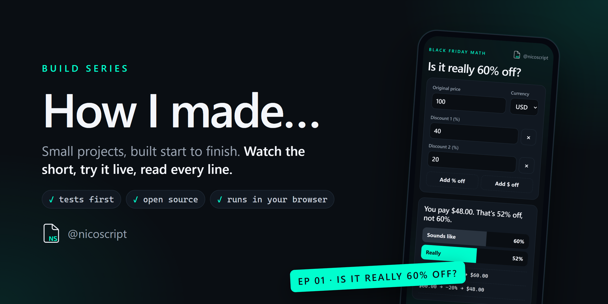
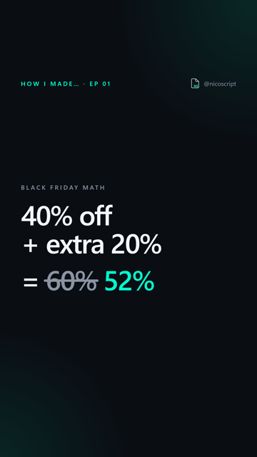

<p align="center">
  
</p>

<p align="center">
  <a href="https://monsieur-nico.github.io/how-i-made/"><b>Try every episode live</b></a>
  &nbsp;·&nbsp;
  <a href="#episodes">Episodes</a>
  &nbsp;·&nbsp;
  <a href="https://www.instagram.com/nicoscript/">Instagram</a>
  &nbsp;·&nbsp;
  <a href="https://github.com/Monsieur-Nico/how-i-made/issues/new?template=episode-idea.yml">Suggest an episode</a>
</p>

<p align="center">
  <a href="https://github.com/Monsieur-Nico/how-i-made/actions/workflows/pages.yml"></a>
  <a href="LICENSE"></a>
  
</p>

Every episode of **How I made…** is one small, finished project. The short video shows it go from an empty page to the result in under a minute. This repo has the rest: the full code, the tests, and a live version you can use right now.

## Episodes

<table>
  <tr>
    <td width="180" valign="top">
      <a href="episodes/01-discount-calculator"></a>
    </td>
    <td valign="top">
      <sub>EP 01 · BLACK FRIDAY MATH</sub>
      <h3>Is it really 60% off?</h3>
      <p>"40% off, plus an extra 20%" sounds like 60% off. It's 52%. A calculator that stacks discounts the way a checkout does and shows what you really save, step by step.</p>
      <p>
        <a href="https://monsieur-nico.github.io/how-i-made/01-discount-calculator/"><b>Try it live</b></a>
        &nbsp;·&nbsp; <a href="episodes/01-discount-calculator">Code &amp; how it works</a>
        &nbsp;·&nbsp; <a href="https://www.instagram.com/reel/DfzBziLBGHR/">Watch on Instagram</a>
      </p>
      <sub>TypeScript · Vite · Vitest · Playwright</sub>
    </td>
  </tr>
</table>

## How every episode is built

1. **A real problem, small enough for one day.** Something people run into, solved in a page you can open on your phone.
2. **Tests first.** The rules are written down as failing tests before any code exists, so the video can show them going from red to green.
3. **The smallest version that works.** Plain and ugly, but correct.
4. **Then the design.** Light and dark themes, readable contrast, works with a keyboard.
5. **Shipped.** Published to the [live site](https://monsieur-nico.github.io/how-i-made/) automatically, with the full code here under MIT.

Nothing an episode does leaves your browser: no accounts, no tracking, no server.

## Run an episode yourself

Each episode lives in its own folder under [`episodes/`](episodes) and stands on its own, with its own README and dependencies. You need [Node.js](https://nodejs.org) 20 or newer.

```bash
git clone https://github.com/Monsieur-Nico/how-i-made.git
cd how-i-made/episodes/01-discount-calculator
npm install
npm run dev
```

`npm test` runs the unit tests, and `npm run verify` runs everything, including the browser tests.

## Suggest an episode

Got a small, annoying problem you'd like to see built? [Open an episode idea](https://github.com/Monsieur-Nico/how-i-made/issues/new?template=episode-idea.yml). The best ones become episodes.

## License

[MIT](LICENSE): use the code however you like, including in your own projects.
