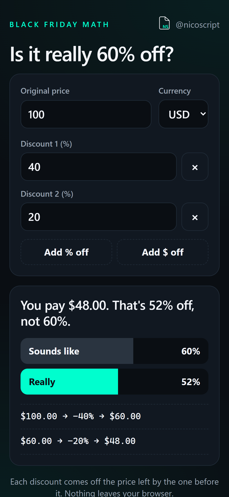

# Episode 01: Is it really 60% off?

"40% off, plus an extra 20% at checkout" sounds like 60% off. It's 52%.

The second discount comes off the price that's left after the first one, not off the original price. This page stacks discounts the way a checkout does and shows the real price, the real percentage off, and every step in between.



## The math

Each discount is applied to whatever the price is after the one before it:

```
$100.00 → −40% → $60.00
$60.00  → −20% → $48.00
```

$48 out of $100 is 52% off. Two discounts of 40% and 20% only add up to 60% if both come off the original price, and checkouts don't do that.

A few details the calculator gets right:

- **Money is counted in cents**, never in floating point, and every step is rounded to the cent, the way a till does it.
- **Order matters** once a fixed amount is in the stack: $10 off then 50% off a $100 item is $45, but 50% off then $10 off is $40.
- **A price never goes below zero**, however much you stack.
- **"Sounds like"** is what the ad adds up to: the percentages, plus each fixed amount as a share of the original price, capped at 100%.

The whole calculation is one loop in [`src/calc.ts`](src/calc.ts).

## Run it

You need [Node.js](https://nodejs.org) 20 or newer.

```bash
npm install
npm run dev
```

Open the address it prints. Change the price, add a percentage or a fixed amount, remove one with the × button. The address bar keeps your stack, so you can send it to someone as a link:

```
?price=100&cur=USD&d=40p,20p,10a
```

`p` is a percentage and `a` is a fixed amount in the chosen currency.

## Tests

```bash
npm test           # the math, the link format and the number formatting
npm run test:e2e   # the page in a real browser (uses the Chrome you already have installed)
npm run verify     # type check, both test suites and a production build
```

The tests were written before the code: `tests/calc.test.ts` pins the 40% + 20% = 52% example, the order-matters case, rounding at every step and the zero floor.

## Files

```
src/calc.ts     the discount math, no browser code
src/url.ts      reading and writing a stack from the link
src/format.ts   money and percentages
src/main.ts     the page
src/style.css   light and dark themes
tests/          unit tests (Vitest)
e2e/            browser tests (Playwright), including a contrast check in light and dark mode
```

Nothing is sent anywhere: no server, no analytics, no cookies.

## License

MIT, like the rest of the [series](../../README.md).
